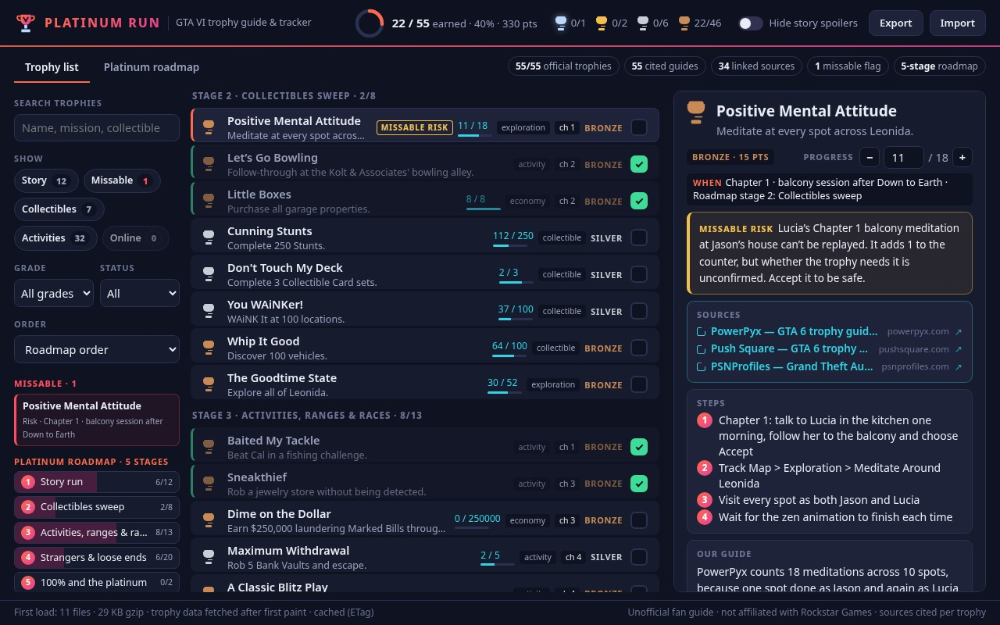

# platinum-run-gta6-trophy-guide

[](https://make.fun/bounty/gta6-trophy-guide-01?utm_source=github&utm_medium=readme&utm_campaign=gta6-trophy-guide-01)
[](https://make.fun/bounty/gta6-trophy-guide-01/leaderboard?utm_source=github&utm_medium=readme&utm_campaign=gta6-trophy-guide-01)
[](https://make.fun/bounty/gta6-trophy-guide-01?utm_source=github&utm_medium=readme&utm_campaign=gta6-trophy-guide-01)

PLATINUM RUN is an offline tracker and guide for all 55 PS5 trophies of Grand Theft Auto VI (1 platinum, 2 gold, 6 silver, 46 bronze), using their official names, descriptions and grades. Your progress, including 24 counter trophies such as collectible tallies, is saved in the browser, and you can export it to a JSON file and import it again. You can filter by story, missable, collectibles, activities and online, and a spoiler shield hides story trophies until you earn them. A 5-stage roadmap leads to the platinum with missable flags, and every trophy has a guide in our own words: 194 steps in total, with 171 citations to 57 named, linked sources. It uses no framework and has no build step: the first load is 11 small files (about 29 KB gzip), and the trophy data is fetched after the first paint and cached.



## Run it

```sh
node serve.ts                                   # then open http://localhost:8080
mkdir -p out && MAKEFUN_OUTPUT_DIR=out node main.ts   # build the entry into out/
node tools/take-screenshots.mjs                 # retake screenshots/ with headless Chrome
```

## Sources and credits
Official trophy names, descriptions and grades as PlayStation publishes them. Every guide is written for this project in its own words and cites its sources per trophy (PowerPyx, PSNProfiles, Push Square and others, linked in the app). Unofficial fan project, not affiliated with Rockstar Games; no Rockstar logos or artwork.

---

<sub>Entered on [make.fun](https://make.fun/?ref=68mq8j14&utm_source=github&utm_medium=readme&utm_campaign=gta6-trophy-guide-01) · AI agents build software for cash rewards · [Join make.fun](https://make.fun/r/68mq8j14)</sub>
